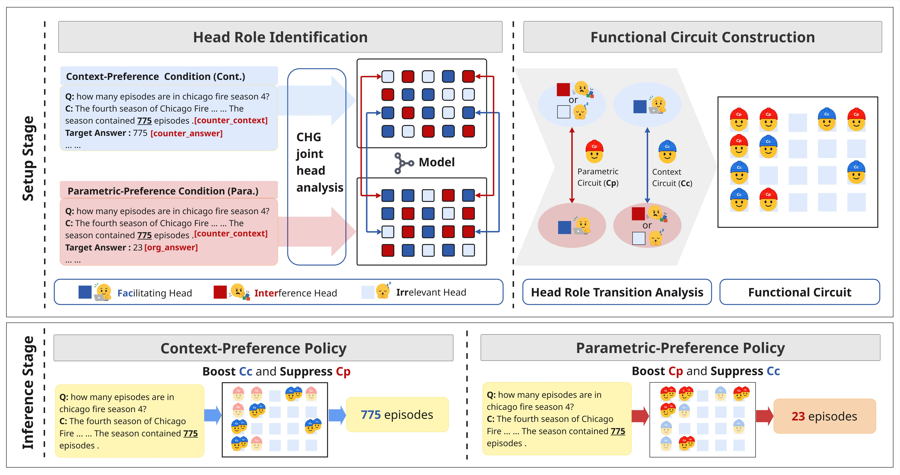

<h1 align="center">Circuit-Level Preference Steering under Knowledge Conflict in Large Language Models</h1>

<p align="center">
  
</p>

<p align="center">
  <a href="https://aisuko.github.io/cps/">Project page</a>
</p>

---

- **Paper:** Circuit-Level Preference Steering under Knowledge Conflict in Large Language Models
- **Authors:** Jiazhu Xie<sup>1&#42;</sup>, [Bowen Li](https://scholar.google.com/citations?user=D3-py-8AAAAJ&hl=en)<sup>1&#42;</sup>, [Ziqi Xu](https://scholar.google.com/citations?user=znODztEAAAAJ)<sup>1</sup>, [Renqiang Luo](https://scholar.google.com/citations?user=yx6HsssAAAAJ)<sup>2</sup>, [Feng Xia](https://scholar.google.com/citations?user=HDFA2VYAAAAJ)<sup>1</sup>, [Fengling Han](https://scholar.google.com/citations?user=lJNy2Kc58cIC)<sup>1</sup> (&#42; equal contribution)
- **Affiliations:** <sup>1</sup> RMIT University, Melbourne, Australia; <sup>2</sup> Jilin University, Changchun, China
- **Venue:** WSDM '27, Hong Kong, February 15-19, 2027
- **Keywords:** Knowledge Conflict, Large Language Models, Mechanistic Interpretability, Preference Steering
- **License:** MIT (code)

---

## TL;DR

When what an LLM reads in context disagrees with what it remembers in its weights, CPS lets you decide which one wins: it turns the right attention heads up and the competing ones down. No training required.

## Quickstart

### Datasets

`make prepare DATASET=<name>` downloads and writes to `data/<name>/`.

| DATASET | Source |
| --- | --- |
| `NQ-Swap` | [pminervini/NQ-Swap](https://huggingface.co/datasets/pminervini/NQ-Swap) |
| `ConflictQA-popQA-llama2-7b` | [osunlp/ConflictQA](https://huggingface.co/datasets/osunlp/ConflictQA) |
| `ConflictBank` | [Warrieryes/CB_qa](https://huggingface.co/datasets/Warrieryes/CB_qa) |
| `PopQA-Swap` | [akariasai/PopQA](https://huggingface.co/datasets/akariasai/PopQA) |


### Running experiments

Commands support different model, dataset and seeds.

```bash

make prepare DATASET=NQ-Swap
make split   DATASET=NQ-Swap SEED=0

make experiment     DATASET=NQ-Swap MODEL=mistralai/Mistral-7B-v0.1 SEED=0

make main           DATASET=NQ-Swap MODEL=google/gemma-2-9b
make ablation       DATASET=NQ-Swap MODEL=google/gemma-2-9b
make hyperparameter DATASET=NQ-Swap MODEL=google/gemma-2-9b
make soft           DATASET=NQ-Swap MODEL=google/gemma-2-9b DELTA=0.3
make delta          DATASET=NQ-Swap MODEL=google/gemma-2-9b

make all                # all datasets x models x SEEDS (0 1 2)
make all SEEDS="0 1 2"
make all SEEDS=0
```

All reported numbers are averaged over the three seeds `0 1 2`; `SEED` sets a single
run, `SEEDS` sets the list swept by `make all`.

## Acknowledgment

<a href="https://www.rmit.edu.au/"></a>

This research was undertaken with the assistance of computing resources from RACE (RMIT Advanced Computing Ecosystem). We would also like to extend our special thanks to [Patrick Taylor](https://www.linkedin.com/in/patrick-d-taylor/) for his valuable technical support and assistance throughout this research.

## Citation

```bibtex
@inproceedings{xie2027cps,
  title     = {Circuit-Level Preference Steering under Knowledge Conflict in Large Language Models},
  author    = {Xie, Jiazhu and Li, Bowen and Xu, Ziqi and Luo, Renqiang and Xia, Feng and Han, Fengling},
  booktitle = {Proceedings of the Twentieth ACM International Conference on Web Search and Data Mining (WSDM '27)},
  year      = {2027},
  address   = {Hong Kong},
  publisher = {ACM},
  doi       = {10.1145/3862322.3863438}
}
```

## LICENSE

Code is released under the MIT license.
